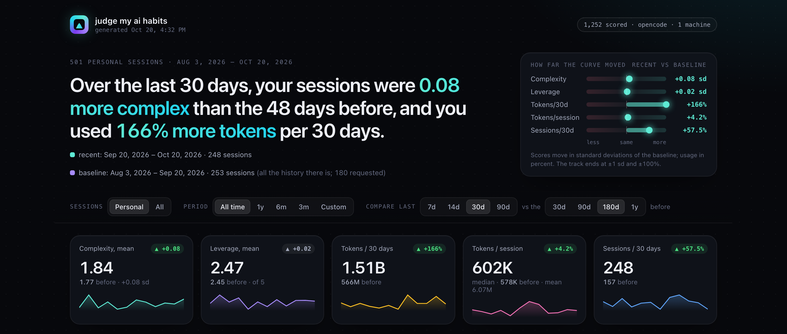
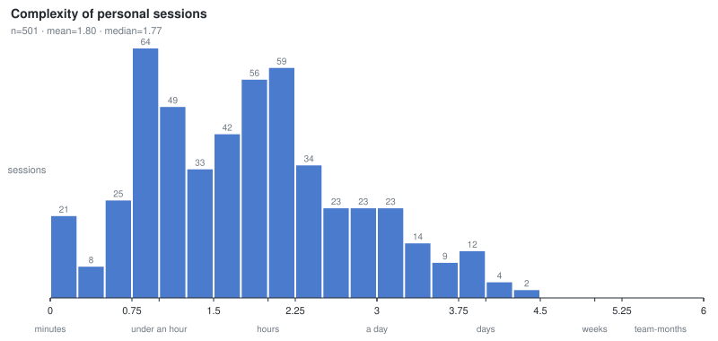
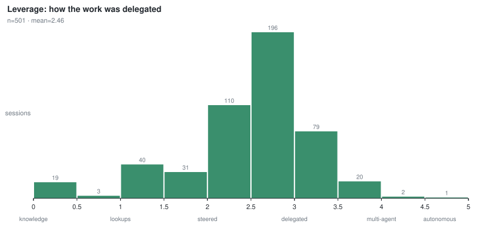
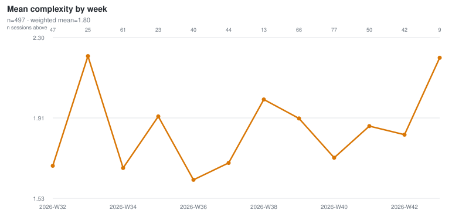
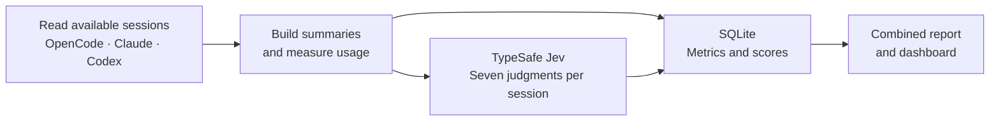

## TL;DR

**Are you asking AI bigger questions—or just burning more tokens?**

Turn your **Claude Code / Cowork, Codex, and OpenCode** history into an interactive
dashboard of your AI habits. See how ambitious your tasks are, how much you
delegate, and how your token usage changes over time—all across harnesses and
machines.

**One script. Your existing sessions. No tracking setup.** Requires Python 3.9+
and a [TypeSafe API key](https://console.typesafe.ai). Session summaries go to
TypeSafe for scoring; your results and dashboard stay local.

## Try it

On macOS or Linux with **Python 3.9+** and `curl`, set your
[TypeSafe API key](https://console.typesafe.ai) and run:

```sh
export TYPESAFE_API_KEY="your-key"
curl -fsSL https://github.com/adunne09/judge-my-ai-habits/releases/latest/download/run.sh | bash
```

Open the dashboard path printed at the end. Re-run the same command whenever you
want an update; it scores only new or changed sessions.

**No clone, installation, or PATH changes.** The runner verifies the download,
runs it temporarily, and cleans up the code afterward. Your results persist at
`~/.local/share/judge-my-ai-habits/` (or under `$XDG_DATA_HOME`).

## Your habits, at a glance

Three lenses on the work you do with AI:

- **Complexity:** how big was the task you asked for?
- **Leverage:** how much of the work did you delegate?
- **Tokens:** how much usage did it take, including subagents?

Complexity and leverage are model judgments; token usage comes from your harness
records. Compare your last 30 days with earlier work and explore individual sessions.



*Example from the October 20, 2026 single-harness dataset. Your dashboard uses
your own sessions and shows harness/machine filters when multiple are present.*

Every completed scoring run (except `--dry-run`) also writes a self-contained,
interactive HTML dashboard, prints its path, and in a terminal asks whether to
open it. It has no external requests and works offline.

<details>
<summary>Explore the dashboard controls and example charts</summary>

Click through time ranges and comparison windows. You can also:

- Switch the curve between complexity and leverage.
- Click a bar or a week to list its sessions.
- Explore the size × delegation map.
- Filter by **Harness** or **Machine**. Each dropdown appears when the database
  has scored sessions from more than one harness or machine. Choose one value or
  all; the charts, comparisons, and session list update together.
- Sort scored sessions by date, complexity, leverage, or tokens; search by
  session id, harness, or machine; open a session to see how Jev split its judgment.

Harnesses with only empty/error rows do not appear in the dashboard. Harness
comparison currently uses these filters; there is no side-by-side or stacked
breakdown. Settings are kept in the URL, so a view can be bookmarked.

Example charts from an earlier OpenCode dataset:







</details>

### More ways to run

Pass options or subcommands with `bash -s --`:

```sh
curl -fsSL https://github.com/adunne09/judge-my-ai-habits/releases/latest/download/run.sh \
  | bash -s -- report

curl -fsSL https://github.com/adunne09/judge-my-ai-habits/releases/latest/download/run.sh \
  | bash -s -- dashboard --open
```

Each invocation downloads the tool again; the existing scores make repeat runs
incremental. Reports and dashboard rendering need no API key. You can also save
`run.sh` wherever you like and run `bash run.sh [options]`.

<details>
<summary>Pin a release</summary>

```sh
curl -fsSL https://github.com/adunne09/judge-my-ai-habits/releases/download/v0.2.0/run.sh \
  | JMAIH_VERSION=v0.2.0 bash
```

</details>

<details>
<summary>Or ask your coding agent to run it for you</summary>

Paste this into the coding agent you use most:

```text
Run judge-my-ai-habits (https://github.com/adunne09/judge-my-ai-habits) on my
sessions across all supported harnesses installed on this machine.

1. Read https://github.com/adunne09/judge-my-ai-habits#readme. Use its run.sh
   runner, or an existing clone.
2. Check the "Supported harnesses" table in README.md. The script discovers all
   supported harnesses automatically, regardless of which agent is running it.
3. If TYPESAFE_API_KEY isn't set, ask me for it. Never print, log, or commit it.
4. Run the curl-to-bash command in README.md, then repeat it with `bash -s -- report`.
   In a clone, use `./judge-my-ai-habits` and `./judge-my-ai-habits report`. Only read the
   harnesses' data; never modify it. Mention any skipped or failed harnesses.
5. In a few sentences, tell me how my last 30 days compare with the time before
   (complexity, leverage, tokens), and give me the dashboard path it printed.
```

</details>

Using another harness? See [Add support for another harness](#add-support-for-another-harness).

## How it works



- **One scoring request per session.** A session's user messages, the agent's
  actions, its final reply, and a few computed facts about how the session ran
  (steps per message, active working time, subagents launched, other AI tools
  invoked) are sent as one state to [TypeSafe](https://www.typesafe.ai)'s Jev
  scoring model. Jev answers several questions in parallel over that state.
- **Complexity is a 7-level scale anchored at both ends.** The bottom is
  calibrated on the smallest real sessions: greetings, tool checks, and
  questions answered from knowledge. The top is anchored on the most complex
  usage people post about publicly: autonomous multi-agent campaigns, such as a
  two-week framework migration shipped as ~600 pull requests, a compiler port,
  or hundreds of designed proteins sent for lab testing. Synthetic sessions
  modeled on those examples score 5.3–6.0, leaving headroom above the ordinary
  personal work in the original validation sample.
- **Leverage is judged separately from size.** A tiny task can be delegated
  ("clean this up") and a huge one can be steered. The scale runs from answered
  from knowledge → a lookup → steered step by step → delegated goal →
  orchestrated agents → autonomous loop.
- **Only personal work feeds the trend.** Each session also gets an origin
  classification (personal work, scripted job, or test/benchmark) plus
  deterministic flags for forks and program-launched sessions. Non-empty
  top-level sessions are scored; the report and charts default to the personal
  subset. Use `report --all` or the dashboard's All toggle to include the rest.
- **Validated against hand labels.** The original OpenCode evaluation used 65
  hand-rated sessions (31 development, 34 blind holdout), reaching complexity
  Spearman 0.96 / 0.95. Claude and Codex have separate evaluations, including
  below-target results and small samples. Later repeat checks exceeded the
  original 0.05 maximum drift; see [Validation by harness](#validation-by-harness).
- **Comparable over time and across tools.** The model is pinned, and every row
  records the scorer hash and model version. Changing the questions rescores
  everything automatically, and every harness shares the same questions.
- **Mergeable.** Each machine writes its own SQLite database. Databases from
  different machines and harnesses merge into one.
- **Shows the change.** By default the report compares your last 30 days with
  the 180 days before, for complexity, leverage, and token usage, so you can see
  whether the curve is moving.

The method is written up as a harness-independent [specification](SPEC.md), so it
can be reimplemented for any agent client.

## Supported harnesses

| Harness | Status | `--harness` |
| --- | --- | --- |
| [OpenCode](https://opencode.ai) v2 | Supported | `opencode` |
| Claude: [Claude Code](https://claude.com/claude-code) (CLI, IDE extensions) and the Claude desktop app (Code tab and Cowork) | Supported | `claude` |
| Codex (CLI, IDE extension, desktop app's local sessions) | Supported | `codex` |
| Cursor | Not supported | |

To add another harness, see
[Add support for another harness](#add-support-for-another-harness).

The default is **`--harness all`**: discover every supported harness, score sessions
not yet scored into the same database, and render one combined dashboard.
No separate runs or merge step are needed on one machine. Missing installations
or transcripts are reported and skipped. A harness that fails to read is
reported separately; the others still run, then the command exits nonzero so an
incomplete scan is visible. Selecting `--harness codex` (or another id) limits
discovery to that harness and makes missing data an error.

### Harness notes: OpenCode

Needs OpenCode v2 on `PATH` or in `~/.opencode/bin`. Sessions are read through
`opencode api`, so the adapter works with whatever server and storage the global
installation uses and never opens OpenCode's database directly. Responses are
written to a temp file, because `opencode api` can truncate large responses
written to a pipe. Child sessions (`parentID`) are subagents. A launcher
`metadata.source` or per-session `permissions` marks program-launched sessions.

### Harness notes: Claude

One harness covers everything that runs on Claude Code's engine: the CLI, the
IDE extensions, and the Claude desktop app's Code tab and Cowork mode. They all
write the same JSONL transcripts, so they are scored the same way and stored as
`harness = 'claude'`. The adapter reads, read-only:

- `~/.claude/projects/<project>/<session>.jsonl` (or `$CLAUDE_CONFIG_DIR/projects`):
  the CLI, the IDE extensions, and the desktop Code tab.
- `~/Library/Application Support/Claude/local-agent-mode-sessions/…/local_<id>/.claude/projects/…/<session>.jsonl`:
  Cowork, one folder per Cowork session.
- The desktop app's per-session `local_<id>.json` files beside them, for
  connector names, Cowork titles, and which transcript a session currently shows.

No `claude` binary is needed. A partial last line, from a session that's still
writing, is skipped. Desktop and claude.ai **chat** conversations are not
covered: they are stored in your account, not on disk (see Known gaps).

Mapping decisions:

- **User messages** are `user` records holding text the person typed. Left out:
  - tool results, skill expansions (`isMeta`), and compaction summaries
  - interrupt notices, slash-command output, and `<system-reminder>` blocks
  - prompts whose `origin` isn't human: subagent hand-backs and task notifications

  Messages typed while the agent was busy arrive as `queued_command` attachments
  and count when their origin is human. A slash command counts as what was typed
  (`/name args`), except built-in UI commands such as `/model` or `/clear`. `!`
  shell commands become `user ran shell: …`. `@` file mentions and pasted images
  count as attachments.
- **Agent steps**: each content block of an API response is its own record.
  Blocks that share a `message.id` are one step. Error notices the engine
  writes itself (model `<synthetic>`) are dropped.
- **Tools** map onto the shared vocabulary:
  - `Bash` and Cowork's sandbox `workspace.bash` → `shell`
  - `Agent`/`Task` → `subagent`
  - `TodoWrite`/`TaskCreate` → `todowrite`, and so on.

  MCP tools become `server.tool`. The desktop app names claude.ai connectors by
  UUID; the adapter reads their names from the app's session files, so
  `mcp__<uuid>__slack_read_thread` reads as `slack.slack_read_thread`.
  Bookkeeping with no counterpart in other harnesses is dropped: `ToolSearch`,
  `TaskList`, the Code tab's end-of-turn summary card, and Cowork's
  folder-access prompts and file cards.
- **Per-session temp paths** (`/private/tmp/claude-502/<project>/<session>/scratchpad`)
  are shortened to `$SCRATCHPAD`, as home paths become `~`. Left in,
  `/claude-502` matches the shared AI-CLI pattern, and nearly every desktop
  session reads as "ran the `claude` CLI". That counts as evidence for the
  orchestration levels of `leverage`.
- **Subagents** are `<session>/subagents/agent-*.jsonl`. They become child
  sessions with ids `<session>/agent-…`, so their tokens roll up and they count
  toward `subagents_launched`. Older layouts (inline `isSidechain` records and
  project-level `agent-*.jsonl` files) are handled the same way but weren't
  available to test.
- **Forks**: rewinding or branching in the Code tab, and resuming in Cowork,
  copy a session's history (message uuids included) into a new transcript. Of
  the transcripts that start with the same message, the one the desktop app
  currently shows is the original, else the earliest. The rest get `fork_of`.
- **`launched_by_program`** is set in two cases:
  - The session was started by `claude -p` or an Agent SDK (entrypoint
    `sdk-cli`, `sdk-ts`, `sdk-py`) and its first prompt isn't marked as human.
  - The first prompt's `origin` isn't human.

  The desktop app drives the engine through the SDK too, but it records
  entrypoint `claude-desktop` (Code tab) or `local-agent` (Cowork) and a human
  origin, so its sessions count as personal.
- **`updated`** is the latest record timestamp across the transcript and its
  subagents, not the file's mtime. Rewriting a file without changing record
  timestamps does not trigger a rescore.
- **Titles** come from the latest `custom-title`, else `ai-title`, else
  `summary` record. Cowork transcripts have none, so the desktop app's title is used.
- **Tokens** are summed once per `message.id`. Thinking tokens are part of
  `output_tokens` and are stored as `tokens_reasoning`.
- **Ids** are the engine's session UUIDs, unprefixed: OpenCode uses `ses_…`
  and Codex uses `codex:…`, so they don't collide.

Known gaps:

- **Chats aren't covered.** Conversations in the desktop app's chat or on
  claude.ai live in your Anthropic account. Neither app keeps them on disk in a
  readable form. Supporting them would mean reading claude.ai's official data
  export (Settings → Privacy → Export data). The adapter doesn't do that yet;
  no export was available to build and validate against.
- **Cost is NULL.** The engine doesn't record per-message cost.
- **Untested signals.** `launched_by_program` wasn't exercised on the
  validation machine, which had no SDK, `-p`, or scheduled sessions. Nor were
  the older subagent layouts. Desktop scheduled tasks and sessions spawned by
  other sessions have no deterministic marker the adapter knows of yet.
- **Stray starts in Cowork.** A Cowork session that was restarted before its
  first reply can leave a short extra transcript that starts with a different
  message, so it isn't caught as a fork.
- **Desktop metadata is macOS only.** On Linux, only the Claude Code projects
  directory (`~/.claude/projects` or `$CLAUDE_CONFIG_DIR/projects`) is read.
- **Transcript retention.** Claude Code deletes transcripts after
  `cleanupPeriodDays` (default 30), so score regularly or raise that setting to
  keep history.

### Harness notes: Codex

Reads `~/.codex/sessions/**/*.jsonl`, `~/.codex/archived_sessions/**/*.jsonl`,
and titles from `~/.codex/session_index.jsonl`. Set `CODEX_HOME` to use a different
data directory. No Codex binary is required, and its databases are never opened.
The CLI, IDE extension, and desktop app share this rollout format.

Mapping decisions:

- **One conversation, not one file.** Group rollout segments by the metadata's
  session id. Resumed desktop conversations can have several files with different
  UUID suffixes. `history_base` links between these segments are not treated as
  forks. Identical records, completed item ids, and response usage ids are
  deduplicated. Incomplete JSONL lines are skipped.
- **User messages** prefer explicit `UserMessage` completion events (or legacy
  `user_message` events). Those distinguish real prompts from environment,
  AGENTS.md, skill, and compaction context injected into user-role messages.
  Older response-only rollouts use filtered user-role messages. Attachments
  count as attachments; their contents are not sent.
- **Assistant messages** use completed `AgentMessage` events when present,
  otherwise assistant response items. Mirrored response items aren't counted
  twice. Reasoning, tool outputs, and compaction replacement histories are omitted.
- **Tools** normalize shell argv / `exec_command` to `shell`, `spawn_agent` to
  `subagent`, `update_plan` to `todowrite`, and MCP names to `server.tool`.
  Native web search/open/find calls and image-generation calls are counted too.
  Patches retain affected paths, not file contents. Code-mode `exec` wrappers
  use the actual completed shell, web, and MCP actions when recorded. Otherwise,
  literal JSON arguments are parsed without executing JavaScript; dynamic code
  falls back to an `execute` summary. Tool discovery is omitted. Temporary
  attachment paths are shortened so they don't falsely count as running Codex.
- **Tokens** use modern per-response `token_usage_record.usage`, deduplicated by
  response id, or the last legacy cumulative `token_count` snapshot. If a session
  spans an upgrade, its legacy prefix is retained alongside modern usage. Cached
  input is already included in input tokens, and reasoning is included in output
  tokens: both are split out before summing, never added twice. Missing usage and
  all costs are NULL.
- **Subagents / forks:** `source.subagent.thread_spawn.parent_thread_id` links
  child sessions; explicit `forked_from_id` / `forked_from` marks forks.
  Descendant usage and update times roll up to the root. Session ids are prefixed
  `codex:` to avoid collisions with Claude UUIDs.
- **Program launches:** `source = exec` or `sdk`, subagent sources, and explicit
  automation / scheduled / heartbeat thread sources are flagged. Desktop / IDE
  `source = vscode` and interactive `cli` sessions remain personal candidates.
- **Updated times** come from transcript activity, including child activity;
  desktop settings-only events and title-index changes don't trigger rescoring.

Known gaps:

- Only locally retained rollouts are covered; cloud-only tasks aren't downloaded.
- Subagent and explicit fork handling have synthetic regression fixtures, but
  were not validated on real examples. SDK and automation / scheduled / heartbeat
  source markers are implemented but were not exercised in this validation.
- A missing rollout segment cannot be reconstructed. Dynamic code-mode arguments
  without completion events retain only a compact code/tool-name summary.
- Version-specific injected user text in response-only histories may need more
  filtering as Codex evolves. Legacy cumulative usage assumes the counter does
  not reset; modern per-response records avoid that ambiguity.
- The oldest pre-envelope JSONL format is also read. It has a bare session header
  followed by response items, without per-message timestamps or usage. Tokens
  stay NULL; active-time metrics cannot be reconstructed, and file mtime is used
  to detect updates. Repeated prompts are preserved even without message ids.

## Run it

The examples below use a checkout. Without a checkout, pass the same arguments
to the runner using `curl …/run.sh | bash -s -- [arguments]`, as shown above.

The scoring script uses only the Python standard library. It needs Python 3.9+
on macOS or Linux and local data from a supported harness. Keep `dashboard.html`
beside the script to render dashboards. A TypeSafe API key is needed when a run
has sessions to score; reports, dashboard rendering, dry runs, and no-change
scoring runs work without one.

```sh
export TYPESAFE_API_KEY=...            # https://console.typesafe.ai
./judge-my-ai-habits                   # discover all supported harnesses, score new sessions, render one dashboard
./judge-my-ai-habits --harness codex   # optional: only Codex
./judge-my-ai-habits report            # recent change, histograms, tokens, and a monthly trend
./judge-my-ai-habits report --by week
./judge-my-ai-habits dashboard --open  # interactive HTML dashboard
python3 make_charts.py                 # regenerate the SVG charts in this README from the DB
```

`report` covers personal sessions over **all of your history** by default. It
opens with the **change**: your last 30 days compared with the 180 days before
them, for session complexity, leverage, and token usage. Windows of different
lengths are compared fairly, as rates per 30 days and as per-session figures. If
there are fewer than 180 days of history before the recent window, the baseline
uses the available span. If you have less than a month, the recent window is all
the history there is, and there's no baseline yet. Example from the combined
two-machine run on October 21, 2026:

```text
CHANGE — last 30 days vs the 180 days before:
  recent:   Sep 21, 2026 – Oct 21, 2026 (30 days)
  baseline: Mar 25, 2026 – Sep 21, 2026 (180 days)

                                  recent   baseline   change
  sessions                           107        586
  sessions per 30 days               107         98   +9.6%
  complexity mean                   1.58       1.77   -0.19 (-11.0%, -0.19 sd)
  complexity median                 1.48       1.82   -0.34
  leverage mean                     2.00       2.03   -0.03
  tokens per 30 days             532.34M    421.74M   +26.2%
  tokens per session, mean         4.98M      4.33M   +15.0%
  tokens per session, median     203.59K    466.79K   -56.4%
```

The complexity change is also given in standard deviations of the baseline
(`sd`), which is the natural unit for "how far has the bell curve moved". Token
counts include subagents. Unknown token totals are excluded from token averages;
totals sum only recorded usage. For an even-sized sample, the CLI's median is
the upper middle observed value.

| `report` flag | Effect |
| --- | --- |
| `--since 2026-06-01`, `--until 2026-09-30` | Limit everything to a date range. `--until` also ends the recent window (default: now) |
| `--recent-days 30` | Length of the recent window |
| `--baseline-days 180` | Length of the baseline window just before it |
| `--by month\|week\|day` | Grouping for the trend table |
| `--all` | Include tests, scripted jobs, and forks |
| `--db PATH` | Read a different database, for example a merged one |

Results go to `~/.local/share/judge-my-ai-habits/analytics.sqlite`. Change that
with `--db`; `$XDG_DATA_HOME` overrides `~/.local/share` when set. Each row is keyed by `(machine, session_id)` and
records its `harness`. `machine` is the short hostname; override it with
`--machine`.

Runs are incremental, so a rerun only pays for sessions Jev hasn't judged yet.
A session is sent to Jev only if it is new, if its last attempt failed, if it was
empty last time and has changed since, or if the questions changed (a new scorer
hash; scores from different question sets aren't comparable). A session that was
already scored is skipped even if it grew afterwards, and keeps its stored row; use
`--rescore-changed` to rescore those too. Each run prints the split, for example
`1,324 already scored, skipped; 3 new to score`. A full first
run on about 1,260 sessions took about a minute and used 3.4M Jev input tokens,
about $0.14.

Changing adapter code or `--model` alone does not invalidate existing rows. Use
`--rescore` to apply those changes to every session.

At the end of an interactive run (stdin and stdout are a terminal), the script asks
`Open the dashboard in your browser? [Y/n]`. Enter opens it; `n`, Ctrl-C, or
Ctrl-D doesn't. Pipes, scripts, and CI are never asked. `--open` opens without
asking and `--no-open` skips the question; `dashboard` takes the same flags.

Other `score` options:

| Flag | Effect |
| --- | --- |
| `--harness all` | Read every available supported harness (default); use `opencode`, `claude`, or `codex` to select one |
| `--since 2026-09-01` | Only sessions created on or after that date |
| `--limit N` | Score at most N sessions total across selected harnesses, newest first |
| `--session <id>` | Score specific sessions (repeatable) |
| `--rescore` | Score every session again, even ones already scored |
| `--rescore-changed` | Also rescore scored sessions that grew since they were scored |
| `--open`, `--no-open` | Open the dashboard at the end without asking, or don't ask |
| `--dry-run` | Print pending sessions' states and metrics without calling Jev; defaults to three sessions, or `--limit N`. Add `--rescore` to inspect sessions already scored |
| `--workers 6` | Parallel sessions |
| `--model jev-1.13.0` | Jev model, pinned on purpose (see below) |

## Several machines and harnesses

Run the script once on each machine; it discovers all supported harnesses. Then copy the
databases to one place and merge them:

```sh
mkdir -p data
scp laptop:.local/share/judge-my-ai-habits/analytics.sqlite data/laptop.sqlite
scp desktop:.local/share/judge-my-ai-habits/analytics.sqlite data/desktop.sqlite
./judge-my-ai-habits merge data/*.sqlite -o all.sqlite
./judge-my-ai-habits report --db all.sqlite
./judge-my-ai-habits dashboard --db all.sqlite
```

Merge upserts session rows by `(machine, session_id)`: for a matching key, the
last input wins. It does not compare score timestamps or remove rows missing
from the inputs. Re-merging doesn't duplicate session rows, but it does append
run-history rows again. The same session id on different machines remains two
rows. Use a new output path for a clean rebuild instead of merging into an
existing aggregate.

Databases created by older versions merge too. If the inputs were scored with
different questions or models, the merge prints a warning because those scores
aren't directly comparable. `merge` does not render a dashboard automatically;
the separate command above does.

## What the database contains (and doesn't)

The database lives at `~/.local/share/judge-my-ai-habits/analytics.sqlite` and
can be copied between machines. It holds one `sessions` row per processed
top-level session, keyed by `(machine, session_id)`, with status `scored`,
`empty`, or `error`, plus a `runs` table of scoring-run metadata.

- **Contains:** session id, harness, machine label, model names, timestamps
  and calendar buckets, message / tool-call / subagent / file counts, active
  and wall time, token and cost totals, the Jev scores and answer
  probabilities, and the scorer and model versions that produced them. Rows also
  include origin / fork / launcher flags, launch source, outcome, status, and
  error text for failed attempts. Jev's scoring input-token count is stored
  separately from the harness's token usage.
- **Does not contain:** session titles, working directories, or project ids.
  The scorer reads them while it works (Jev judges partly from the title and
  the action summary), but they are dropped before anything is written, and
  the dashboard — which reads only the database — shows none of them either.
  `score` and `merge` strip and vacuum these fields from an older **output**
  database when opening it. Merge also omits them when copying input rows; it
  does not rewrite the input files. `report` and `dashboard` do not migrate or
  clean their input database.

The database does not store the assembled request state or complete transcripts.
The individual input/output/cache/reasoning token columns describe the root
session; `tokens_total` includes its descendants and is NULL if any included
session lacks usage. `cost_usd` sums recorded costs and is NULL when none are known.

DuckDB can also read all of them together without merging:

```sql
INSTALL sqlite; LOAD sqlite;
SELECT * FROM sqlite_scan('data/laptop.sqlite', 'sessions')
UNION ALL BY NAME
SELECT * FROM sqlite_scan('data/desktop.sqlite', 'sessions');
```

## What gets scored

Each eligible top-level session becomes one request to Jev. Descendants'
tokens, recorded costs, and subagent-session count roll up to their top-level parent.
Message, tool-call, and timing metrics describe the parent's own transcript. The
parent's delegation tool calls describe assigned work in its actions; child
transcripts are not concatenated into the request. The request state contains:

- `session_title`
- `user_messages`: recognized human messages, clipped to a target of 2,500
  characters each, retaining the beginning and end. Above a 12,000-character
  text budget, the first and latest messages are kept and middle messages are dropped.
- `agent_actions`: a one-line summary of each tool call in order, for example
  `shell: git clone …`, `edit: ~/repos/x/y.ts`, or `linear.save_issue: …`.
  Tool names from every harness are mapped onto one shared vocabulary, so the
  same work reads the same way whichever tool did it. Repeats are collapsed. The
  trace retains up to 80 entries, plus an omission marker when sampled. This
  includes markers where the user sent another message.
- `agent_final_reply`: the agent's last text reply, clipped to a target of 1,800 characters.
- `work_pattern`: plain-language facts about how the session ran, computed in
  code: how many messages the user sent, tool calls per user message (rounded),
  and estimated active time within turns (each gap capped at 30 minutes,
  excluding the wait for the next user message),
  how many subagents were launched, and which other AI CLIs (`codex`, `claude`,
  `gemini`, `amp`, …) the agent ran from the shell.

The request to [TypeSafe](https://www.typesafe.ai) is a JSON object with three
fields: `model` (the pinned Jev version), `state` (the summary above), and
`questions` (all seven scoring/classification definitions). The API key is sent
in the Authorization header.

Tool outputs, reasoning blocks, and file contents are not attached separately.
Text already present in retained user messages, assistant replies, or tool
arguments can still appear in the summary. The character limits are targets:
omission markers add characters, and text within 40 characters of a per-message
limit is left intact. A typical state is 1k to 7k tokens. Jev returns scores,
probabilities, confidence, model, and API usage as JSON; see [SPEC.md](SPEC.md).

Sessions with no user message or no assistant message get `status = 'empty'` and
aren't sent to Jev.

### Questions

All seven questions go in the same request, so they're answered in parallel over
the same state.

**`complexity` (0 to 6)** is the headline number. It's a Score question: "How much
work would it take skilled professionals, working without AI, to do everything the
user asked for in this session?" The levels are:

| Level | Meaning |
| --- | --- |
| 0 | A couple of minutes |
| 1 | Under an hour: one small, well-defined task |
| 2 | A few hours: a multi-step task |
| 3 | About a full day: a substantial piece of work |
| 4 | Several days: a multi-part project |
| 5 | Weeks: a large project for one person |
| 6 | Months of work for a team of specialists |

Level 6 is anchored on the most complex real usage people post about publicly
(frontier practice, found by surveying X/Twitter in October 2026): migrating a
large production web app to a different framework through hundreds of pull
requests (a two-week autonomous loop, ~600 PRs), porting a compiler to another
language, and computationally designing hundreds of candidate proteins and
sending them for lab testing. In these sessions the user only sets a goal and
checks in every few days. Ordinary interactive sessions sit far below that.

Each level also carries generic examples. The score is the probability-weighted
level, so it's continuous, for example 2.37. The probability for each level is
stored too, in `complexity_p0` through `complexity_p6`.

**`leverage` (0 to 5)** asks "How did the user put AI to work in this session?"
It judges the way work was delegated and organized, independent of size:

| Level | Meaning |
| --- | --- |
| 0 | Answered from the model's own knowledge, no actions taken |
| 1 | One or two lookups or commands run on the user's behalf |
| 2 | Steered step by step, agent acts between messages |
| 3 | Delegated a goal; the agent planned, carried out, and checked the work |
| 4 | Orchestrated several AI agents: subagents, worktrees, or other AI tools toward one goal |
| 5 | Ran an autonomous agent system: agents plan, implement, review, and verify over many hours or days with occasional check-ins |

The other four Scores are stored as separate dimensions, each from 0 to 3. They
aren't folded into `complexity`:

- `scope`: how many distinct deliverables the user asked for
- `expertise`: how much specialized skill the work needs
- `systems`: how many external systems or codebases the work coordinates
- `open_endedness`: how much the agent had to work out for itself

`origin` is a Choice between `personal_work`, `scripted_job`, and
`test_or_benchmark`. Rows also carry a deterministic flag, `launched_by_program`.
It's set from signals in the harness's own records that a program, not a
person, started the session, such as an SDK or API launch, a scheduler, or a
headless run.

Jev's per-question answers are kept in `answers_json`, excluding the repeated
criteria legends. You can recompute summaries derived from those probabilities
without calling Jev again.

### Why this design

Several designs were compared against hand ratings of 65 sessions on the same
0 to 4 effort scale. 31 of them were used to develop the questions and 34 were a
blind holdout, rated before seeing any Jev output. Spearman rank correlation with
the hand ratings:

| Design | Development | Holdout |
| --- | --- | --- |
| Title and first message only | 0.83 | 0.76 |
| All user messages | 0.94 | 0.93 |
| User messages, actions, and final reply | 0.96 | 0.97 |
| Same, with a generic example on each level | 0.96 | 0.96 |
| v2: 7 levels with a frontier-anchored top, plus `work_pattern` in the state | 0.96 | 0.95 |
| Weighted mix of scope, ambiguity, expertise, and systems | 0.79 | 0.92 |
| `jev-preview` (1.14) instead of 1.13 | 0.96 | 0.95 |
| Tool-call count alone, without Jev | 0.79 | 0.94 |

Takeaways:

- Including what the agent actually did matters. Asking from the first message
  alone misses follow-ups and underestimates sessions that grew.
- A single, concrete "how long would a skilled person take" question beat a
  weighted mix of narrower dimensions. Of those dimensions, `open_endedness`
  tracked overall size least (about 0.5). That makes it a useful separate signal:
  delegating more open-ended work over time is its own kind of progress.
- Counting tool calls is a decent proxy on average, but it rewards an agent that
  flails. Jev rates the request, not the agent's activity.
- The original repeat runs differed by at most 0.05; later checks showed larger
  individual shifts (see the per-harness results below).
- Doubling the actions and user-text limits moved scores on the 10 largest
  sessions by about 0.1, which isn't enough to justify the extra tokens.
- The scale has a sixth level ("weeks") because the largest sessions were pinned
  at the top of a five-level scale. Without it, the right tail of the curve can't
  move. Rank agreement was unchanged (0.96 on both sets). Surveying frontier AI
  usage posted on X added a seventh level ("months of work for a team"), anchored
  on autonomous multi-agent campaigns (hundreds of PRs over weeks, compiler ports,
  protein design runs lab-tested in days). Synthetic sessions modelled on those
  posts score 5.3–6.0, above the ordinary personal sessions in the original
  sample, so the top of the scale has headroom. Rank agreement was unchanged
  (0.96 dev / 0.95 holdout).

`origin` alone isn't reliable for scripted jobs. In testing it caught all 15
eval sessions, but it called 9 of 13 launcher-created sessions personal work. That
is why the `human_sessions` view also requires `launched_by_program = 0`.

### Validation by harness

Each harness has separate validation results and limitations against the protocol in
[SPEC.md section 8](SPEC.md#8-validating-a-new-harness), using
`validation/agreement.py` (hand labels vs. scores) and
`validation/check_frontier.py` (the synthetic frontier anchors must stay at the
top of the scale).

| Harness | Dev Spearman | Holdout Spearman | Frontier check | Repeat-run drift |
| --- | --- | --- | --- | --- |
| OpenCode v2 | 0.96 (31) | 0.95 (34) | Pass: 5.3–6.0 complexity, 4.9–5.0 leverage | Originally ≤ 0.05; later max 0.10 complexity |
| Claude (engine 2.1) | 0.96 (16) | 0.87 (14) | Pass: 5.3–6.0 complexity, 4.9–5.0 leverage | mean 0.02, max 0.12 (see below) |
| Codex (0.45–0.155 rollouts) | 0.85 (30) | 0.92 (16) | Pass: 5.35–6.00 complexity, 4.90–5.00 leverage | mean 0.02, max 0.06 |

**Codex.** Validated on 56 local rollout files representing 50 conversations:
46 had both a real user message and an assistant response; four were empty or
abandoned starts. Labels for complexity and leverage were assigned from states
before scoring: 30 development sessions and 16 blind holdout sessions. This is
fewer than the protocol's requested 20 holdout sessions, and mostly short
research / chat tasks rather than large coding projects.

Two adapter iterations were scored with the same questions, model, and frozen
labels:

| Codex variant (dev, n=30) | Complexity Spearman | Complexity MAE | Leverage Spearman |
| --- | --- | --- | --- |
| First pass: grouped segments, canonical message events, completed code-mode actions | 0.847 | 0.320 | 0.895 |
| Second pass: literal code-mode fallback, web-open mapping, discovery filtering, temp-path normalization | 0.847 | 0.312 | 0.887 |

The second pass is kept for more faithful states, not a claimed improvement in
correlation. For example, shell commands inside wrappers now retain their
arguments and website opens are identified as fetches instead of searches.
Development complexity is **below the 0.90 target**. The largest disagreements
were how much effort to assign short research requests, and whether a few
lookups across follow-ups count as steered work or simple lookups; inspection
didn't find missing user requests in those states. Labels and shared questions
were not changed to chase agreement.

The untouched holdout scored **0.919 complexity Spearman (MAE 0.281)** and
**0.849 leverage Spearman (MAE 0.407)**. All five synthetic frontier checks
passed. Treat these as small-sample validation, not full coverage of Codex's
subagent, automation, or fork behavior. Subagent and explicit fork paths have
offline synthetic tests; automation markers remain unvalidated.

**Codex repeatability:** two fresh scoring passes over 20 frozen development
states differed by mean 0.020 / max 0.060 in complexity and mean 0.007 / max
0.060 in leverage. An OpenCode control on the same day (18 usable sessions of
20 sampled) differed by mean 0.023 / max 0.100 in complexity and mean 0.003 /
max 0.030 in leverage. Codex drift was comparable to the existing harness.

**End-to-end checks:** the default all-harness run discovered 1,900 top-level
sessions (1,849 OpenCode, one empty Claude transcript, 50 Codex). It stored 1,798
scores and 102 empty rows with zero errors. All rows used the existing scorer
hash and model. Splitting by harness and merging reproduced all 1,900 rows
exactly; the dashboard included both harnesses with scored data. An unchanged
Codex rerun had zero pending sessions. All 18 offline regression tests passed,
including mixed-version resumes, nested subagents, missing-harness handling,
global limits, incremental combined runs, pre-envelope history, and native web
and image-generation calls. A later scan of a second machine exposed the
pre-envelope format; that coverage was added without changing the 50 original
Codex states or their validation results.

**Two-machine rebuild (October 21, 2026):** a subsequent fresh run scanned both
the Mac Studio and MacBook, including 10 older Codex transcripts discovered on
the MacBook. The replacement aggregate contained **4,651 top-level sessions:
3,376 scored, 1,275 empty, and zero errors**. Its personal view contained 1,511
sessions. Of the scored sessions, 3,150 came from OpenCode and 226 from Codex;
the only local Claude transcript was empty. This verifies broader discovery and
aggregation, not a second hand-labeled evaluation.

**Origin spot-check:** 42 of 46 scored Codex sessions entered the personal view.
Two greetings were classified as tests, but so were a real factual lookup and
a skill-install request. These are false exclusions by the shared origin
classifier, not deterministic launcher flags; use `report --all` to include them.

**Claude.** The validation machine had 31 usable sessions: 15 from the CLI and
the desktop Code tab, and 16 from Cowork. That is fewer than the protocol's
30 + 20. They were split into 16 dev and 15 holdout sessions and labelled from
their states before any scoring. One holdout session turned out to be empty,
leaving 14.

Validation ran before two later additions: Cowork titles from the desktop
app, and preferring the transcript the app currently shows when picking a
fork's original. Those change titles and which copy is flagged as a fork. The
rest of each state is unchanged.

- **Dev:** complexity Spearman 0.96 (MAE 0.22); leverage 0.92.
- **Holdout**, scored once with no tuning: complexity 0.87 (MAE 0.41), below the
  0.90 target; leverage 0.60.
- **Why the holdout is lower.** It is crowded at the low end: 10 of 14 labels
  are 1 or 1.5, so a few rank swaps cost a lot.
  - Complexity: three of those are near-identical "install this MCP server"
    sessions where the agent refused or stopped at a plan awaiting approval; Jev
    put them at about 2.0. Two Cowork sessions (a briefing setup and a video
    lesson build) scored about a level above their labels.
  - Leverage: for the two plan-awaiting-approval sessions, where nothing ran,
    Jev gave about 1.7 against labels of 0.5. In dev, a similar no-action
    session went the other way: labelled 2, scored 1.0. "Delegated, but
    nothing happened" is ambiguous on the leverage scale; that comes from the
    question, not the adapter.
- **Split by source:** holdout complexity is 0.82 on CLI/Code-tab sessions (8)
  and 0.93 on Cowork sessions (6). Holdout leverage is 0.16 on CLI/Code-tab
  sessions, almost all of them tied MCP-setup sessions, and 0.85 on Cowork.

Treat these numbers as small-sample; the dev set is
where adapter choices were compared:

| Claude variant (dev, n=16) | Complexity | Leverage |
| --- | --- | --- |
| Adapter as shipped | 0.96 | 0.92 |
| Temp paths left raw (`/tmp/claude-502/…` matches the AI-CLI pattern) | 0.97 | 0.90 |
| Bookkeeping tools kept (`ToolSearch`, summary card) | 0.97 | 0.92 |
| Raw tool names (`Bash`, `mcp__<uuid>__…`) instead of the shared vocabulary | 0.97 | 0.88 |

Complexity barely moves between variants. Leverage is where the vocabulary and
the temp-path fix pay off; per session, the changes moved leverage by up to
0.36. The temp-path fix is kept for correctness either way: without it,
`other_ai_agents_run_from_shell` claims the `claude` CLI ran in nearly every
desktop session.

**Repeat-run drift.** Rescoring 30 sessions twice moved complexity by 0.02 on
average and at most 0.12, and leverage by at most 0.19. Eight sessions moved by
more than 0.05. The same check on 20 OpenCode sessions, on the same day, gave
the same picture (mean 0.02; max 0.10 complexity, 0.19 leverage). So this is
Jev's own variation today, not the adapter. The ≤ 0.05 figure in the OpenCode
row is from its original validation.

### Keeping scores comparable over time

The model is pinned to `jev-1.13.0` rather than the moving `jev-latest` alias.
Every row records `jev_model` and `scorer_hash`. The hash covers the questions and
the state limits, so if you edit a question, the next run rescores everything.
Compare trends only within one `scorer_hash` and `jev_model`. Every harness uses
the same questions, so they share one hash.

## Querying

The `human_sessions` view keeps scored sessions that are personal work, not forks,
and not launched by a program. Use `sessions` directly for everything.

```sql
-- Bell curve: counts in 0.25-wide bins
SELECT ROUND(complexity * 4) / 4.0 AS bin, COUNT(*) AS n
FROM human_sessions GROUP BY bin ORDER BY bin;

-- Mean shift per month, per machine and harness
SELECT month, machine, harness, COUNT(*) AS n, ROUND(AVG(complexity), 2) AS mean_complexity
FROM human_sessions GROUP BY month, machine, harness ORDER BY month, machine, harness;

-- Expected share of sessions at each level, per week (uses the probabilities, not the rounded score)
SELECT week, COUNT(*) AS n,
       ROUND(AVG(complexity_p0), 3) AS minutes, ROUND(AVG(complexity_p1), 3) AS under_hour,
       ROUND(AVG(complexity_p2), 3) AS hours,   ROUND(AVG(complexity_p3), 3) AS day,
       ROUND(AVG(complexity_p4), 3) AS days,    ROUND(AVG(complexity_p5), 3) AS weeks,
       ROUND(AVG(complexity_p6), 3) AS team_months
FROM human_sessions GROUP BY week ORDER BY week;

-- Leverage: are you delegating and orchestrating more over time?
SELECT month, ROUND(AVG(leverage), 2) AS mean_leverage,
       SUM(leverage >= 3) AS delegated_or_higher, SUM(leverage >= 4) AS multi_agent
FROM human_sessions GROUP BY month ORDER BY month;

-- Token usage over time, including subagents
SELECT month, SUM(tokens_total) AS tokens, ROUND(SUM(cost_usd), 2) AS cost_usd
FROM sessions GROUP BY month ORDER BY month;

-- Complexity per token: are you getting more done per unit of compute?
SELECT month, ROUND(AVG(complexity), 2) AS mean_complexity,
       ROUND(AVG(tokens_total) / 1e6, 2) AS mean_mtokens
FROM human_sessions GROUP BY month ORDER BY month;

-- Your most complex sessions
SELECT day, machine, harness, ROUND(complexity, 2) AS complexity, session_id
FROM human_sessions ORDER BY complexity DESC LIMIT 20;
```

The `day`, `week`, and `month` columns use the local time of the machine that ran
the script. `created_ms` and `created_at` (UTC) are there for anything finer.

## Build and publish a release

Maintainers can build the portable macOS/Linux package manually from a checkout:

```sh
python3 -m unittest discover -s validation -p 'test_*.py'
bash scripts/build.sh v0.2.0
```

This writes three files to `dist/v0.2.0/`:

- `judge-my-ai-habits.tar.gz` — the Python script, dashboard template, and version
- `run.sh` — downloads and runs the tool temporarily, without installing it
- `SHA256SUMS` — SHA-256 checksums for both files

The archive uses an explicit file allowlist and reproducible metadata. It contains
no local sessions, databases, API keys, or generated dashboards. The same package
works on macOS and Linux, on Apple Silicon/ARM and Intel/AMD, using Python 3.9+.

After committing and pushing the source, publish the files with the GitHub CLI
(use a **new version** for each release):

```sh
gh release create v0.2.0 dist/v0.2.0/* \
  --target "$(git rev-parse HEAD)" --title v0.2.0 --generate-notes
```

Alternatively, choose **Actions → Build and release → Run workflow** on GitHub
and enter the new version. The manual workflow runs the tests on macOS and Linux,
builds the files, and uploads them both as workflow artifacts and GitHub Release
assets. Versions containing a suffix such as `-rc.1` become prereleases; the
default runner follows the latest stable release. Releases are only created
when explicitly requested, not on every push.

## Add support for another harness

[SPEC.md](SPEC.md) defines the whole method independently of any harness: the
adapter contract, the common message format, the shared tool vocabulary, the
exact state rules, the Jev request, the storage schema, and the validation
protocol. A new harness needs only an adapter. The questions, limits, and model
stay the same, so its scores merge with everyone else's.

The fastest way to add one is to have an agent do it from inside the harness you
want to support. Copy the prompt below and paste it into that harness as is; the
agent already knows which harness it's running in.

````text
Add support for the harness you're running in right now to judge-my-ai-habits
(https://github.com/adunne09/judge-my-ai-habits). The tool scores AI agent
sessions for complexity (0–6) and leverage (0–5) with TypeSafe's Jev and stores
the results in mergeable SQLite. OpenCode v2, Claude, and Codex are supported today. Your goal:
`./judge-my-ai-habits score --harness <id>` works for the current harness, and
its scores are comparable with the existing ones. If the current harness is
already supported, tell me and stop.

Ground rules
- Clone the repo (or open it if it's already local). Read README.md, SPEC.md,
  judge-my-ai-habits, and validation/ end to end before changing anything.
  SPEC.md is the contract. The OpenCode adapter (class OpenCode, open_opencode,
  and the HARNESSES registry) is the worked example to follow.
- Stdlib-only Python 3.9+, macOS and Linux only. Add the adapter inside the
  single judge-my-ai-habits script.
- Access the harness's data read-only. Never modify, lock, or migrate it.
- Never print, log, or commit the TypeSafe API key, session content, hand
  labels, or scratch databases.
- Do not change QUESTIONS, the state limits, or the model pin. The scorer hash
  must stay identical so the new rows merge with existing ones. If you become
  convinced a question must change, stop and show me the evidence first.

Step 1: Find the data. Work out where and how the current harness stores session
history on this machine: local files, a local database, a CLI or API, or an
official export. Verify this by inspecting real data rather than assuming.
Report what you found: the location and format, and how sessions, user
messages, assistant turns, tool calls (including MCP tools), subagents, titles,
timestamps, token usage, and program-launched sessions are represented. Also
report what's missing. If history isn't available locally, stop and propose
options (for example an official data export) before writing code.

Step 2: Write the adapter. Implement name, version(), sessions(), and
messages() as SPEC.md section 3 describes, mapping onto the session record and
the common message format, and register it in HARNESSES. The default all-harness
run will then discover it automatically. Raise HarnessUnavailable from the opener
when the harness isn't installed or has no transcripts. Pay special attention
to:
- excluding synthetic user-role messages (tool results, reminders, summaries)
- mapping tool names onto the shared vocabulary, with MCP tools as server.tool
- child sessions and subagents
- the launched_by_program signal
- `updated` times that change whenever a session gains content
- id prefixes, if ids could collide with another harness's

Step 3: Inspect states. Run
`./judge-my-ai-habits score --harness <id> --dry-run --limit 10`, then
`--dry-run --session <id>` on hand-picked sessions: tiny ones, huge ones,
tool-heavy ones, and ones with subagents. Read every state. The same kind of
work should read the same way it does for OpenCode.

Step 4: Iterate manually with Jev. Use the existing repo as guidance for how
to call the API: the Jev class and QUESTIONS in judge-my-ai-habits, SPEC.md
section 6, and validation/check_frontier.py. If TYPESAFE_API_KEY isn't set, ask
me for it. Before scoring at scale:
  a. Pick about 30 varied sessions. Label each yourself on complexity (0–6,
     halves are fine) and leverage (0–5) from the states alone, before you see
     any Jev output. Save these as labels-dev.json. Label 20 more the same way
     as a blind holdout in labels-holdout.json, and don't look at their scores yet.
  b. Score the dev set into a scratch database (`--db /tmp/jmaih-dev.sqlite`,
     repeating `--session`), then run
     `python3 validation/agreement.py --db /tmp/jmaih-dev.sqlite --labels labels-dev.json`,
     once as is and once with `--field leverage`.
  c. Read the biggest disagreements. For each one, decide whether the state
     misrepresented the session (an adapter problem) or your label was wrong.
     Change the state construction, rescore with `--rescore`, and compare. To
     test an idea quickly, call Jev directly on a handcrafted or modified state:
     load the script with importlib as validation/check_frontier.py does, call
     `Jev(key, DEFAULT_MODEL).ask(state, QUESTIONS)`, and read each answer's
     `probabilities` and `confidence`, not only its `score`. Keep a table of
     every variant you tried and its Spearman.
  d. Stop when dev Spearman is at least 0.90 with no obvious systematic error.
     Then score the holdout once and report the result honestly, without
     tuning on it.
  e. Run `python3 validation/check_frontier.py`, which must pass. Rescore 20
      sessions twice and compare drift with an existing harness on the same day.
      Original runs stayed within 0.05, but later checks reached about 0.10–0.12
      complexity and 0.19 leverage; report the observed mean and maximum honestly.

Step 5: Run in full and merge. Score every session into the default database
and run `./judge-my-ai-habits report`. Spot-check the 10 most and 10 least
complex personal sessions, what was filtered out as tests, scripted jobs, or
forks, and the leverage distribution. If a database from another harness is
available, merge them (`./judge-my-ai-habits merge a.sqlite b.sqlite -o all.sqlite`)
and confirm there's no scorer-hash warning. Render the merged dashboard
(`./judge-my-ai-habits dashboard --db all.sqlite`) and check that the new
harness appears in its harness filter and looks right.

Step 6: Document. In README.md, mark the harness as supported in the harness
table, add a "Harness notes" subsection (where the data comes from, mapping
decisions, known gaps), and add its row to "Validation by harness", along with
the variant table from step 4. If you found a gap or ambiguity in SPEC.md, fix
it. Commit on a branch, open a pull request, and summarize for me: what you
found, the decisions you made, the validation numbers, and anything you're
unsure about.
````

## Files

| Path | What it is |
| --- | --- |
| `judge-my-ai-habits` | The tool: harness adapters, state builder, Jev client, `score`, `merge`, `report`, `dashboard` |
| `dashboard.html` | Template for the interactive dashboard; `dashboard` fills it with data from the database |
| `scripts/build.sh` | Builds a portable release archive, runner, and checksums |
| `scripts/run.sh` | Downloads, verifies, and runs a release temporarily without installing |
| `.github/workflows/release.yml` | Manually triggered macOS/Linux checks and GitHub Release publishing |
| `SPEC.md` | Harness-independent specification of the method |
| `make_charts.py` | Regenerates `charts/*.svg` from a results database |
| `validation/agreement.py` | Spearman and error between your hand labels and the scores |
| `validation/check_frontier.py`, `validation/frontier.py` | Synthetic frontier sessions that must score at the top of the scale |
| `validation/test_adapters.py` | Offline synthetic regression checks for Codex and combined discovery; run `python3 -m unittest discover -s validation -p 'test_*.py'` |
| `validation/test_distribution.py` | Offline build, runner cleanup, argument forwarding, and packaged-dashboard checks |
